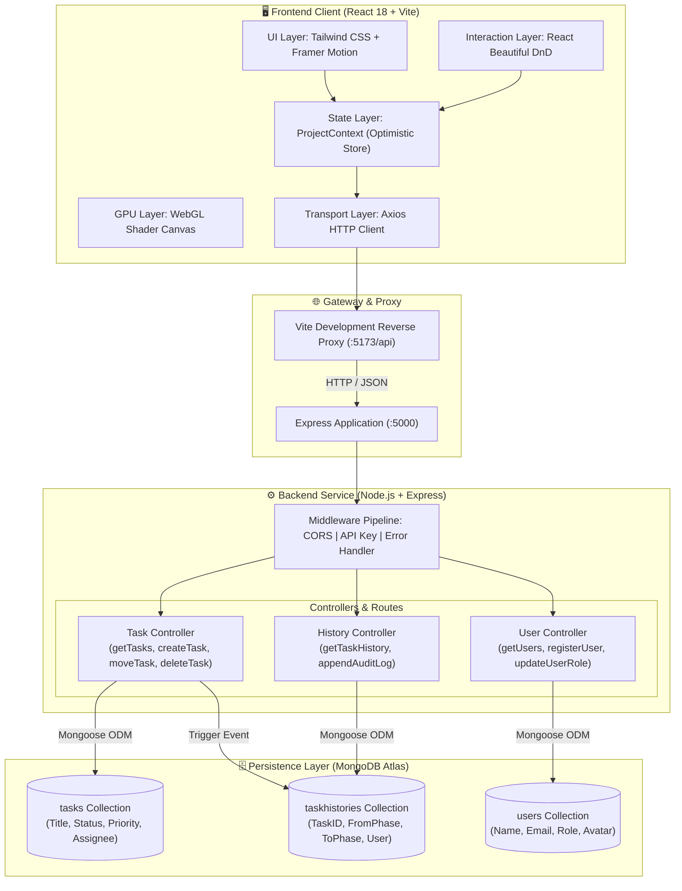

# ⚡ Utpatti Flow — Enterprise SDLC Workflow & Kanban Orchestration Platform

<p align="center">
  <strong>A high-performance full-stack MERN application engineered to model, visualize, and govern the Software Development Life Cycle (SDLC) with real-time kanban workflow, optimistic state reconciliation, and immutable audit tracking.</strong>
</p>

<p align="center">
  <a href="#-architecture--system-design"></a>
  <a href="https://react.dev/"></a>
  <a href="https://nodejs.org/"></a>
  <a href="https://www.mongodb.com/"></a>
  <a href="https://tailwindcss.com/"></a>
  <a href="https://opensource.org/licenses/MIT"></a>
</p>

<p align="center">
  <a href="#-system-overview">Overview</a> •
  <a href="#-key-features">Features</a> •
  <a href="#-architecture--system-design">Architecture</a> •
  <a href="#-engineering-deep-dives">Engineering Highlights</a> •
  <a href="#-database-schema--data-models">Data Models</a> •
  <a href="#-rest-api-specification">API Reference</a> •
  <a href="#-getting-started--local-setup">Setup Guide</a> •
  <a href="#-author--contact">Author</a>
</p>

---

## 📌 System Overview

In fast-paced modern software development teams, task transitions across SDLC stages frequently suffer from:
- **Opaque phase transitions** without verifiable audit records or transition rationale.
- **Fragmented communication** between cross-functional teams (Product, Design, Frontend, Backend, QA, DevOps).
- **Latency-heavy user interfaces** that stutter under drag-and-drop state changes.
- **Lack of granular lifecycle velocity metrics** to diagnose development bottlenecks.

**Utpatti Flow** addresses these industry challenges by delivering a centralized, production-ready SDLC command center. It models the entire engineering lifecycle—from concept through deployment—combining zero-perceived-latency **Optimistic UI**, automated **Immutable Event Audit Logging**, and real-time **Sprint Velocity Analytics**.

---

## ✨ Key Features

| Category | Feature | Engineering Implementation |
| :--- | :--- | :--- |
| 🧩 **SDLC Board** | **Interactive Drag & Drop Workflow** | Multi-column state board (`Design` ➔ `Development` ➔ `Testing` ➔ `Deployment` ➔ `Done`) with fluid drag-and-drop via `react-beautiful-dnd`. |
| ⚡ **Performance** | **Optimistic UI with Rollback** | Client state updates immediately for 60fps UX; automatic reconciliation and state rollback with toast alert if the API call fails. |
| 📜 **Governance** | **Immutable Audit Trail** | Dedicated `TaskHistory` event store logging every transition, origin/destination stage, initiating user, and timestamped comment. |
| 📊 **Analytics** | **Real-Time Project Metrics** | Dynamic calculation of team velocity, backlog density, critical path/high-priority tasks, and stage completion ratios. |
| 👥 **Team Management** | **Role & Access Allocation** | Team directory supporting member onboarding, role assignment (`Developer`, `Manager`, `Designer`, `QA`), and task delegation. |
| 🎨 **Next-Gen UX** | **GPU-Accelerated Shaders** | Custom WebGL GLSL fragment shader background (`three.js`/raw shader canvas) for sleek dark-mode glassmorphic aesthetics. |
| 🛡️ **API Security** | **Tiered Middleware Architecture** | Modular Express middleware stack with API key validation, CORS policies, and centralized asynchronous error interception. |

---

## 🏗️ Architecture & System Design

Utpatti Flow employs a decoupled, layered client-server architecture designed for high maintainability, predictable data flow, and horizontal scalability.



---

## 🔬 Engineering Deep Dives

### 1. Zero-Latency Optimistic UI with Automatic Failure Rollback
In distributed project management tools, waiting for backend round-trip confirmation during task dragging creates noticeable friction. Utpatti Flow utilizes an **Optimistic State Pattern**:
- When a task card is dropped into a new phase, the React context creates a snapshot of the current state (`previousTasks`) and instantly updates the local task list.
- An asynchronous network request (`PUT /api/tasks/:id/move`) is dispatched in the background.
- If the server encounters an error or network drop, the state automatically reverts to `previousTasks` and an interactive error toast is displayed, ensuring guaranteed state consistency without blocking the user.

```javascript
// client/src/context/ProjectContext.jsx
const updateTaskPhase = async (taskId, newPhase) => {
    const previousTasks = [...tasks];
    const taskIndex = tasks.findIndex(t => t._id === taskId);
    if (taskIndex === -1) return;

    // 1. Optimistic local update
    const updatedTask = { ...tasks[taskIndex], status: newPhase };
    const newTasks = [...tasks];
    newTasks[taskIndex] = updatedTask;
    setTasks(newTasks);

    try {
        // 2. Background persistence
        await api.moveTask(taskId, newPhase, currentUser?._id);
    } catch (error) {
        // 3. Rollback on network failure
        setTasks(previousTasks);
        toast.error("Failed to move task. Reverting state.");
    }
};
```

### 2. Dual-Write Immutable Audit Log for SDLC Compliance
Regulatory software delivery standards require an auditable trail of who shifted code from development to deployment. Utpatti Flow enforces audit trail generation inside the task transition controller:
- Any status update triggers an atomic creation of a `TaskHistory` record storing `taskId`, `fromPhase`, `toPhase`, `changedBy`, and custom notes.
- The history collection is append-only, preserving an unalterable chronological record of lifecycle events.

### 3. GPU-Accelerated WebGL Fragment Shaders for Ambient UI
Rather than utilizing heavy video files or static flat colors, Utpatti Flow executes a custom WebGL fragment shader program rendered on an HTML5 canvas. This offloads visual ambient lighting computation directly to the client's GPU, preserving 60 FPS UI performance and delivering a stunning, modern dark-mode aesthetic.

---

## 🗄️ Database Schema & Data Models

The persistence layer is structured with **Mongoose ODM** over MongoDB, enforcing referential integrity with cross-collection population.

```
       ┌────────────────────────┐
       │         User           │
       ├────────────────────────┤
       │ _id: ObjectId          │◄────────┐
       │ name: String           │         │
       │ email: String (Unique) │         │
       │ role: Enum             │         │
       │ avatar: String         │         │
       │ timestamps: true       │         │
       └────────────────────────┘         │
                   ▲                      │
                   │ (assignedTo)         │ (changedBy)
       ┌───────────┴────────────┐         │
       │         Task           │         │
       ├────────────────────────┤         │
       │ _id: ObjectId          │◄──┐     │
       │ title: String          │   │     │
       │ description: String    │   │     │
       │ status: SDLC Enum      │   │     │
       │ priority: Enum         │   │     │
       │ assignedTo: ref(User)  │   │     │
       │ dueDate: Date          │   │     │
       │ timestamps: true       │   │     │
       └────────────────────────┘   │     │
                                    │     │
                       (taskId)     │     │
                       ┌────────────┴─────┴────┐
                       │      TaskHistory      │
                       ├───────────────────────┤
                       │ _id: ObjectId         │
                       │ taskId: ref(Task)     │
                       │ fromPhase: String     │
                       │ toPhase: String       │
                       │ changedBy: ref(User)  │
                       │ comment: String       │
                       │ timestamps: true      │
                       └───────────────────────┘
```

---

## 📡 REST API Specification

### Task Endpoints (`/api/tasks`)

| Method | Endpoint | Description | Request Body | Status Codes |
| :--- | :--- | :--- | :--- | :--- |
| `GET` | `/api/tasks` | Fetch all tasks with populated assignee data | None | `200 OK`, `500 Server Error` |
| `POST` | `/api/tasks` | Create a new task & generate initial history log | `{ title, description, priority, assignedTo, status }` | `201 Created`, `400 Bad Request` |
| `PUT` | `/api/tasks/:id/move` | Transition task to new SDLC phase & log audit | `{ status, userId }` | `200 OK`, `404 Not Found` |
| `DELETE` | `/api/tasks/:id` | Remove a task permanently from the system | None | `200 OK`, `404 Not Found` |
| `GET` | `/api/tasks/:id/history` | Retrieve complete chronological audit trail | None | `200 OK`, `404 Not Found` |

### User Endpoints (`/api/users`)

| Method | Endpoint | Description | Request Body | Status Codes |
| :--- | :--- | :--- | :--- | :--- |
| `GET` | `/api/users` | List all team members and roles | None | `200 OK`, `500 Server Error` |
| `POST` | `/api/users` | Register a new team member | `{ name, email, role, avatar }` | `201 Created`, `400 Bad Request` |
| `PUT` | `/api/users/:id/role` | Update user permissions / team role | `{ role }` | `200 OK`, `404 Not Found` |
| `DELETE` | `/api/users/:id` | Remove a user from the organization | None | `200 OK`, `404 Not Found` |

---

## 💻 Tech Stack & Tooling

```
Utpatti Flow Ecosystem
│
├── Client-Side Architecture
│   ├── Framework: React.js 18.2 with Functional Hooks
│   ├── Build Tooling: Vite 5 (Hot Module Replacement / esbuild)
│   ├── State Management: React Context API with Optimistic Handlers
│   ├── Drag-and-Drop: React Beautiful DnD
│   ├── Styling: Tailwind CSS 3.4 + PostCSS + CSS Modules
│   ├── Graphics & Animation: WebGL Shaders + Framer Motion 11
│   ├── Component Icons: Lucide React
│   └── Notifications: React Toastify
│
├── Server-Side Architecture
│   ├── Runtime: Node.js (v18+)
│   ├── Framework: Express.js 4.18
│   ├── Database Driver: Mongoose ODM 8.1
│   ├── Middleware: CORS, Dotenv, Custom API Key Middleware
│   └── Error Handling: Express Async Handler with Structured Responses
│
└── Database & Deployment
    ├── Database: MongoDB (Atlas / Community Server)
    └── Version Control: Git / GitHub
```

---

## 📂 Project Directory Structure

```text
Utpatti-Flow/
├── client/                     # Frontend Single Page Application
│   ├── public/                 # Static public assets (SVG, icons)
│   ├── src/
│   │   ├── api/                # Axios API instance and service definitions
│   │   ├── components/         # Reusable UI component library
│   │   │   ├── ui/             # WebGL GLSL shader backgrounds
│   │   │   ├── CreateTaskModal.jsx
│   │   │   ├── DashboardLayout.jsx
│   │   │   ├── KanbanBoard.jsx # DnD interactive board implementation
│   │   │   ├── TaskCard.jsx    # Individual draggable task unit
│   │   │   └── TaskHistoryModal.jsx # Audit trail chronological modal
│   │   ├── context/            # React Context API (ProjectProvider)
│   │   ├── pages/              # Primary route views
│   │   │   ├── Dashboard.jsx   # Metrics, velocity, and task overview
│   │   │   ├── LandingPage.jsx # Hero showcase with shader backgrounds
│   │   │   ├── LoginPage.jsx   # Authentication and role access
│   │   │   ├── ProjectsPage.jsx# Searchable, filterable task catalog
│   │   │   ├── SettingsPage.jsx# Preferences, security, and profile config
│   │   │   └── TeamPage.jsx    # Member roster and permission management
│   │   ├── App.jsx             # React Router routing configuration
│   │   ├── main.jsx            # Application entry point
│   │   └── index.css           # Global Tailwind directives & custom utilities
│   ├── tailwind.config.js      # Custom theme color tokens and animations
│   └── vite.config.js          # Vite build config & backend proxy rules
│
├── server/                     # Backend RESTful API Service
│   ├── config/
│   │   └── db.js               # MongoDB Mongoose connection handler
│   ├── controllers/
│   │   ├── taskController.js   # Task CRUD, phase movement & audit logging
│   │   └── userController.js   # User registration, role mutation, deletion
│   ├── middleware/
│   │   ├── authMiddleware.js   # API Key & access security validation
│   │   └── errorMiddleware.js  # Global exception catching & formatted JSON errors
│   ├── models/
│   │   ├── taskModel.js        # Task schema with SDLC enum constraints
│   │   ├── taskHistoryModel.js # Audit schema for lifecycle transitions
│   │   └── userModel.js        # User profile and role schema
│   ├── routes/
│   │   ├── taskRoutes.js       # Express routes for /api/tasks
│   │   └── userRoutes.js       # Express routes for /api/users
│   ├── server.js               # Express application initialization & middleware
│   └── package.json            # Server dependencies and nodemon scripts
│
└── README.md                   # Project documentation & engineering specs
```

---

## ⚙️ Getting Started & Local Setup

### Prerequisites
Make sure you have installed on your local development machine:
- **Node.js**: `v18.0.0` or higher ([Download](https://nodejs.org/))
- **npm**: `v9.0.0` or higher
- **MongoDB**: A running local MongoDB instance or a free [MongoDB Atlas](https://www.mongodb.com/atlas) connection URI
- **Git**

### 1. Clone Repository
```bash
git clone https://github.com/RakeshBabuGajula/Utpatti-Flow.git
cd Utpatti-Flow
```

### 2. Configure Environment Variables
Create a `.env` file in the `server` directory:
```bash
# server/.env
PORT=5000
MONGO_URI=mongodb+srv://<username>:<password>@cluster0.mongodb.net/utpatti_flow?retryWrites=true&w=majority
API_KEY=your_secure_development_api_key
```

### 3. Install Dependencies
```bash
# Install backend dependencies
cd server
npm install

# Install frontend dependencies
cd ../client
npm install
```

### 4. Run the Application
Open two separate terminal windows or tabs:

**Terminal 1 — Backend API Service:**
```bash
cd server
npm run dev
# Server running at http://localhost:5000
```

**Terminal 2 — Frontend Client:**
```bash
cd client
npm run dev
# Vite client running at http://localhost:5173
```

Navigate to `http://localhost:5173` in your web browser.

---

## 🔮 Scalability Roadmap

- [ ] **WebSocket Live Sync (Socket.io)**: Push-based real-time updates so multi-user board movements reflect instantly across all connected sessions.
- [ ] **JWT & Role-Based Access Control (RBAC)**: Fine-grained permissions restricting stage transitions (e.g. only QA can transition tasks from *Testing* to *Deployment*).
- [ ] **Git & CI/CD Webhooks**: Automatic task state transitions triggered by GitHub Pull Request mergers and deployment status webhooks.
- [ ] **Redis Caching Layer**: In-memory caching for frequently accessed project dashboards and high-throughput velocity calculations.
- [ ] **Containerization**: Multi-stage `Dockerfile` and `docker-compose.yml` for unified single-command deployment.

---

## 👨‍💻 Author & Contact

**Rakesh Babu Gajula**  
*Full Stack Developer | Software Engineer*

- **GitHub**: [@RakeshBabuGajula](https://github.com/RakeshBabuGajula)
- **LinkedIn**: [Rakesh Babu Gajula](https://www.linkedin.com/in/rakesh-babu-gajula)
- **Portfolio**: [rakeshbabu.dev](https://github.com/RakeshBabuGajula/my_portfolio)

---

<p align="center">
  <sub>Built with precision and passion for modern software engineering excellence.</sub>
</p>
